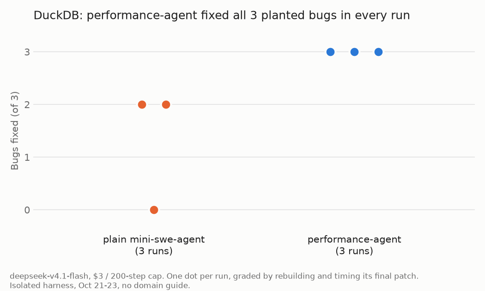
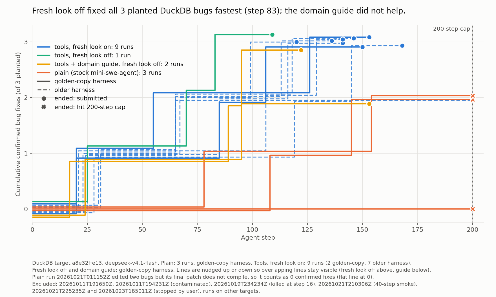
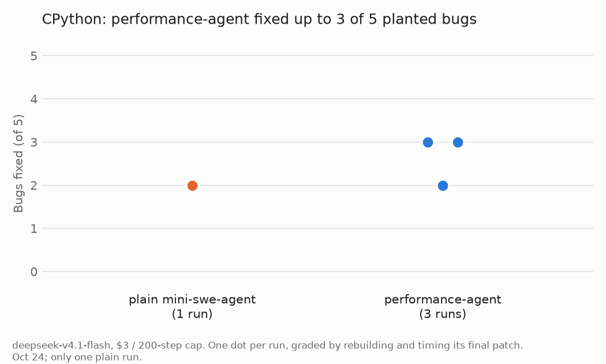

# performance-agent

**An agent that finds and fixes performance bugs in compiled code the way a performance engineer does: it measures, profiles, forms a hypothesis, tests it, and keeps only fixes that a measurement backs up.** The goal is for small, cheap models to do this well enough to run unattended, overnight, across whole codebases.

It is a fork of [mini-swe-agent](https://github.com/SWE-agent/mini-swe-agent). The agent loop, models and environments are unchanged. This fork adds a performance workflow, profiling tools the agent can call, long-run handling, and a sandbox.

## Results so far

We test it by planting known slowdowns in real software, then checking whether the agent finds and fixes them. Every run uses the same cheap model, `deepseek-v4.1-flash`, with a $3 and 200-step cap. "Plain" is stock mini-swe-agent with the same model. Each final patch is graded by us, not the agent: rebuilt from a clean copy, timed against an unplanted build in interleaved rounds, and run through the project's tests.

### DuckDB: all 3 bugs fixed in every run

DuckDB is a C++ analytical database. We planted 3 slowdowns and measured them on the TPC-H benchmark (SF10).



| | Plain mini-swe-agent | performance-agent |
|---|---|---|
| Bugs fixed (of 3) | 2, 2, 0 | **3, 3, 3** |
| How runs ended | all 3 hit the 200-step cap | submitted on their own |
| Benchmark suite after the patch | 7% slower than unplanted | back to unplanted speed |

- **Cheap.** A full run that fixed all 3 bugs cost $0.18 and took about an hour.
- **It solves the bug a profiler can't point at.** Two of the bugs show up in a profile as one hot function, and plain runs fix those too. The third is a bad runtime decision whose cost lands elsewhere. Only performance-agent fixed it: 6 of 7 runs on an older harness, and all 3 on the current one.
- **Its fixes match the real ones.** In the run we checked byte for byte, every fix restored the original upstream code exactly.



Each line is one run, stepping up when a fix that survived to the final patch was made. performance-agent runs (blue, green) fixed the first bug by step 17 to 31; plain runs (red) took 78 to 108 steps. The green run has the "fresh look" feature turned off; it was the fastest, so that feature is now off by default. A domain guide for databases (yellow) did not help.

### CPython: a harder target, 3 of 5 at best

CPython is the C interpreter behind Python. We undid 4 real upstream performance fixes and added 1 synthetic bug, measured with 32 workloads. It is a harder test: some slowdowns are only 7-10%, and fixing one can shrink another.



| | Plain mini-swe-agent | performance-agent |
|---|---|---|
| Bugs fixed (of 5) | 2 (1 run) | 2, 3, 3 |

- **Every run fixed the two largest bugs.** The difference is the third: only performance-agent found the synthetic bug (a string hash that is no longer cached), using `perf-sample --callers` to see which function a hot memory copy came from.
- **Its float fix is line for line the fix CPython shipped upstream.**
- **The two misses taught us something.** On one, the agent found the cause three times and dismissed it each time because another copy of the code looked the same; the workflow now says that clears nothing. The other is too small to see once a larger bug is fixed, which is a problem with the target.

**Small samples.** 1 to 3 runs per setup. An earlier test showed the same model and prompt scoring 0 of 4 and 4 of 4 on two runs, so these are early results, not benchmark numbers.

## How it works

| Piece | What it does |
|---|---|
| **Workflow** ([`workflow.md`](src/minisweagent/config/perf/workflow.md)) | Replaces mini-swe-agent's bug-fix instructions with a performance engineer's order of work: measure, rule out the machine, rank regressions by size, profile the worst, name the code, state a hypothesis that predicts a number, test it within ~10 steps, keep only measured fixes. It also covers traps we watched the model fall into, such as clearing a suspect because "that's how I remember upstream" or because another copy of the code looks the same. |
| **Tools** ([`tools/`](src/minisweagent/config/perf/tools)) | Per-target command-line tools on the agent's PATH. `perf-profile` gives a per-operator query profile. `perf-sample` gives a CPU profile with `--callers` (who calls a hot function) and `--compare` (which functions differ between a slow and a fast workload). `perf-compare` does an interleaved A/B timing of two builds and says whether the difference is beyond noise. |
| **Episodes** ([`perf.py`](src/minisweagent/agents/perf.py)) | Cheap models get worse as the conversation grows. Every N steps the agent writes a handoff note (fixes kept and applied, leads, next experiment), its context is cleared, and a new session starts from the note. On CPython this was the setup that first found the hardest bug. |
| **Sandbox** ([`sandboxed_local.py`](src/minisweagent/environments/sandboxed_local.py)) | Runs each agent command under a macOS `sandbox-exec` profile with a minimal environment; the agent process itself stays outside, so it can still reach the model API. Our profile blocks the network and everything outside the run's copy, so the agent can't copy an answer instead of finding it. |
| **Fresh look** (off by default) | A second reviewer with a clean context, triggered when the agent circles on one file. It never led to a fix in any run, so it's off. |

## How we test

- **Planted bugs with known answers.** Each bug is a real upstream performance fix undone, or one we wrote, measured at well above the noise floor (about ±8% per workload between two builds). A fix either recovers the time or it doesn't.
- **Bugs must not self-heal.** DuckDB corrects many bad choices at runtime, so each planted bug has to survive that.
- **Nothing to copy from.** The target's history is squashed, changelogs and giveaway comments are stripped, every run starts from a fresh copy, and an isolation check flags any attempt to look outside it. Runs did try: searches of the whole disk, GitHub requests, `git fsck` for old objects. Two early runs found a leftover commit and were thrown out; that hole is closed.
- **Several bugs per copy.** A large bug can hide a small one, which is part of the test.

## What's next

- **A Rust target: [arrow-rs](https://github.com/apache/arrow-rs) compute kernels.** Real, measured upstream speedups (1.2x to 20x) that can be undone cleanly, no runtime adaptivity, and a 4-second rebuild after a one-file change.
- **General tools.** One profiling and comparison toolset with a small per-target config, instead of one copy per project.

## Use it

performance-agent is mini-swe-agent with a generated config. Build the config, then run `mini` with it:

```sh
pip install -e .
python src/minisweagent/config/perf/build_config.py perf.yaml --tools duckdb --episode-steps 50
mini -c perf.yaml --model deepseek/deepseek-v4.1-flash --model-class openrouter --task "This build of DuckDB got slower on TPC-H. Find out why and fix it."
```

- `--tools NAME` puts `src/minisweagent/config/perf/tools/NAME` on the agent's PATH (today: `duckdb`, `cpython`). For a new project, copy one and adapt how it builds and runs a workload.
- `--guide NAME` adds a domain guide from `perf/guides/`.
- To sandbox commands (macOS), add `-c environment.environment_class=minisweagent.environments.sandboxed_local.SandboxedLocalEnvironment -c environment.profile=YOUR.sb` with a `sandbox-exec` profile of your own.

For everything else (models, environments, configs), see the [mini-swe-agent docs](https://mini-swe-agent.com/latest/).

## Credit and license

Built on [mini-swe-agent](https://github.com/SWE-agent/mini-swe-agent) by the SWE-bench / SWE-agent team. MIT licensed, as is the original; see [LICENSE.md](LICENSE.md).
